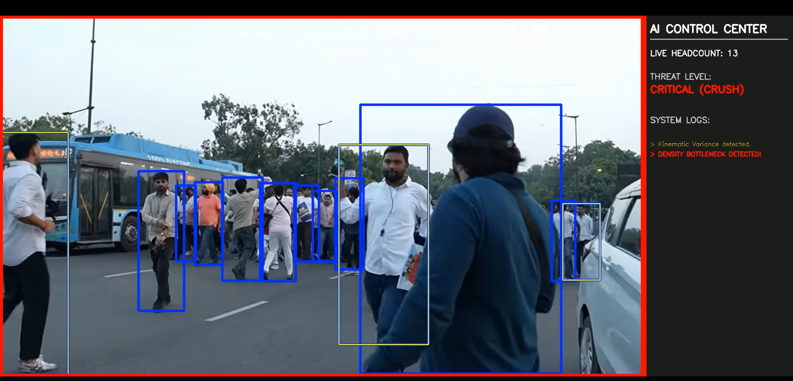

# Predictive Stampede Alert System

A real-time computer vision and crowd-physics analysis engine that shifts crowd surveillance from passive monitoring to predictive early warning. Built with **YOLOv8**, **ByteTrack**, **OpenCV**, and **NumPy**, the system detects sudden panic acceleration and localized crush bottlenecks in unstructured crowds, rendering live telemetry on an unobstructed dual-screen Command Center dashboard.


---

## Key Features

* **Persistent Multi-Object Tracking:** Uses `YOLOv8n` filtered strictly for human detection (`classes=[0]`) paired with `ByteTrack` to maintain persistent identity tracking across frames.
* **Kinematic Variance (Panic Detection):** Tracks each individual's centroid over a **5-frame sliding window** to filter out bounding-box jitter and detect abnormal acceleration using Euclidean displacement:
  $$v = \sqrt{(x_{\text{current}} - x_{t-5})^2 + (y_{\text{current}} - y_{t-5})^2}$$
* **Density Clustering (Crush Hazard):** Evaluates pairwise Euclidean distances between all active centroids in each frame. Flags a global bottleneck when **4 or more individuals** are compacted within a **75-pixel radius**.
* **NumPy Matrix Expansion Dashboard:** Dynamically expands the video frame tensor by `450px` using `numpy.zeros` to create an isolated dark-mode telemetry sidebar—keeping the live camera feed clean and free of default YOLO label clutter.
* **Hierarchical Threat Engine:** Automatically escalates system status across three states:
  * 🟢 **NOMINAL:** Normal crowd flow.
  * 🟡 **ELEVATED (SPEED):** Localized sprinting/kinematic variance detected.
  * 🔴 **CRITICAL (CRUSH):** Severe density bottleneck detected; triggers a global red-border alert on the video feed.

---

## Tech Stack

* **Language:** Python 3.9+
* **Object Detection & Tracking:** Ultralytics YOLOv8, ByteTrack (`lap`)
* **Video & Matrix Processing:** OpenCV (`cv2`), NumPy

---

## Installation & Usage

1. **Clone the repository:**
   ```bash
   git clone [https://github.com/YOUR_USERNAME/predictive-stampede-alert-system.git](https://github.com/YOUR_USERNAME/predictive-stampede-alert-system.git)
   cd predictive-stampede-alert-system